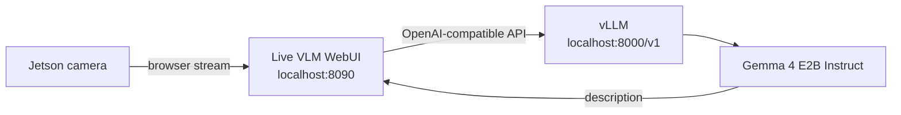

# Gemma 4 Vision Lab

**A local, camera-to-caption demo for Jetson Orin.** A browser streams the camera, Live VLM WebUI prepares frames, and vLLM runs **Gemma 4 E2B Instruct** on the Jetson.

<p align="center">
  <strong>CAMERA → LIVE VLM WEBUI → GEMMA 4 E2B</strong><br>
  Private loopback endpoints · Docker Compose · Jetson GPU
</p>

| Runtime | Model | Web app | License note |
|---|---|---|---|
| NVIDIA Jetson Orin | `google/gemma-4-E2B-it` | Live VLM WebUI | WebUI source retains its Apache 2.0 license |

## Start in three steps

Run these commands on the Jetson itself:

```bash
git clone https://github.com/vivek97vivu/vlm_jetson-gemma4.git
cd vlm_jetson-gemma4
docker compose up -d
```

The first model startup downloads weights if needed, then performs engine warmup. Give it time to finish. Watch progress with:

```bash
docker compose logs -f gemma4-e2b
```

When ready, this endpoint lists the model:

```bash
curl http://localhost:8000/v1/models
```

Open **[http://localhost:8090](http://localhost:8090)** in a browser on the Jetson. Allow camera access, select the webcam, then start analysis. If the model selector has a saved old value, refresh the list and choose **`google/gemma-4-E2B-it`**.

## How the pieces connect



Both services use host networking and bind to loopback. Open the page on the Jetson desktop; `localhost` refers to the machine running the browser. The WebUI source is included under [`live-vlm-webui/`](live-vlm-webui/) and keeps its upstream [Apache 2.0 license](live-vlm-webui/LICENSE).

## The Jetson profile

| Setting | Value |
|---|---:|
| Model | `google/gemma-4-E2B-it` |
| Precision | BF16 |
| Context length | 8,192 tokens |
| Concurrent sequences | 1 |
| GPU memory utilization target | 40% |
| Max generated tokens | 96 |
| Frame processing interval | Every 120 frames |
| WebUI / model API | `localhost:8090` / `localhost:8000/v1` |

These defaults are in [`compose.yaml`](compose.yaml). The GPU limit leaves room for the Jetson desktop; changing it can affect available memory for other applications.

## Operate the stack

```bash
# Current service state
docker compose ps

# Follow both services
docker compose logs -f

# Restart the services
docker compose restart

# Stop the services (keeps downloaded model/cache files)
docker compose down
```

Model weights and runtime compile caches live in `cache/`. They are intentionally excluded from Git because they can occupy many gigabytes. Docker image layers are stored in Docker's configured image store.

## If the page says “Connection error”

The web page can start before vLLM finishes loading Gemma. Check readiness first:

```bash
curl http://localhost:8000/v1/models
docker compose ps
```

The model list should contain `google/gemma-4-E2B-it`. If the API is not ready yet, follow `docker compose logs -f gemma4-e2b` until startup completes, then refresh the page. In the WebUI, refresh the model list and select the exact model ID above. If the containers exited, restart with `docker compose up -d` and inspect `docker compose logs`.

## Repository map

```text
.
├── compose.yaml          # Gemma vLLM and Live VLM WebUI services
├── live-vlm-webui/       # Included WebUI source and upstream license
├── cache/                # Local model/runtime data; ignored by Git
└── README.md
```

## Credits

The included Live VLM WebUI source comes from [NVIDIA AI-IOT/live-vlm-webui](https://github.com/NVIDIA-AI-IOT/live-vlm-webui). Its license and notices are preserved in `live-vlm-webui/`.
